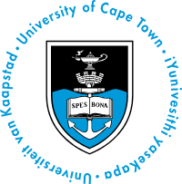

# STA Honours Time Series Portfolio

<table>
  <tr>
    <td>
      <strong>Student:</strong> Ethon Felix<br>
      <strong>Student Number:</strong> FLXETH002<br>
      <strong>Module:</strong> STA Honours Time Series Analysis (2026)<br>
      <strong>Deadline:</strong> 30 October 2026 11:59pm<br>
      <strong>Institution:</strong> <br>University of Cape Town<br>Department of Statistical Sciences
    </td>
    <td align="right">
      
    </td>
  </tr>
</table>

---

## Portfolio Overview

This portfolio showcases four substantial projects in time series analysis, demonstrating competence across statistical theory, computational implementation, and critical reflection. The work spans both classical methods (ARIMA, GARCH, spectral analysis) and modern approaches (state-space models, Kalman filtering, hidden Markov models).

**Course Content:**
- **Part 1:** ARIMA modelling, volatility modelling (ARCH/GARCH), spectral analysis
- **Part 2:** Exponential smoothing, time series regression, state-space models, hidden Markov models

---

## Portfolio Structure

```
portfolio/
├── README.md
├── index.qmd
├── ai-use-log.qmd
├── reflective-commentary.qmd
├── journal/
│   ├── index.qmd
│   └── entries/
├── projects/
│   ├── index.qmd
│   ├── project-01/
│   ├── project-02/
│   ├── project-03/
│   └── project-04/
├── section-1/
│   └── section-1.qmd
├── section-2/
│   └── section-2.qmd
└── appendix/
    └── code-and-data.qmd
```


---

## Substantial Projects

Each project includes:
- **One-page summary** (question, methods, findings, what to do differently, link to detailed analysis)
- **Detailed analysis** (full technical write-up with code and results)

| Project | Type | Topic | Data | Status |
|---------|------|-------|------|--------|
| [Project 1](projects/project-01/) | Implementation / Simulation | [Title] | [Source] | ✓ |
| [Project 2](projects/project-02/) | Exploration / Shiny App | [Title] | [Source] | ✓ |
| [Project 3](projects/project-03/) | Model Comparison | [Title] | [Source] | ✓ |
| [Project 4](projects/project-04/) | Real-world Application | [Title] | [Source] | ✓ |

**Requirements met:**
- ✓ At least one project with model comparison
- ✓ At least one with computational/statistical programming
- ✓ At least one with real-world data

---

## Journal

The [journal](journal/index.qmd) documents learning progress throughout the course:
- Topic covered and session date
- What was done and what was learned
- Difficulties and open questions
- Next steps

[View journal entries](journal/entries/)

---

## Reflective Commentary

[Reflective commentary](reflective-commentary.qmd) (1000–2000 words) covers:
- Learning achievements across both sections
- Methodological challenges and how they were addressed
- Ethical and reproducibility considerations
- Future areas for development

---

## AI Use Log

As per UCT policy, AI use is documented in the [AI use log](ai-use-log.qmd). This includes:
- Date and tool used
- What assistance was requested
- Link to conversation or prompt
- What was checked or changed by the student

See [AI Use Policy](#ai-use-policy) below.

---

## Reproducibility

All analyses are fully reproducible. Required materials:

### Code
R scripts and Quarto notebooks implementing all analyses from first principles. See [appendix/code_and_data.qmd](appendix/code-and-data.qmd) for:
- Time series modelling code (ARIMA, GARCH, state-space)
- Custom implementations of statistical methods
- Data visualisation and diagnostic plots

### Data
Datasets and access instructions:
- South African financial and economic time series
- Real-world data with appropriate anonymisation (where applicable)
- Data statements including source, consent, and POPIA compliance

### Software
- **R version:** 4.x
- **Key packages:** `forecast`, `tseries`, `fGarch`, `dlm`, `depmixS4`
- Install dependencies: `renv::restore()` or manually install packages listed in scripts

---

## How to Navigate This Portfolio

**Starting point:** Visit the [landing page](index.qmd) for an overview.

**By topic:** Browse [section-1](section-1/section-1.qmd) and [section-2](section-2/section-2.qmd) for model fitting, interpretations, and topic reflections.

**By project:** Each [substantial project folder](projects/) contains a one-page summary and a link to the detailed analysis.

**For learning journey:** Follow the [journal](journal/index.qmd) to see progress over time.

**For technical details:** Check the [appendix](appendix/code_and_data.qmd) for all reproducible code and data documentation.

---

## Assessment Rubric

This portfolio is assessed on seven criteria (40% of final grade; oral exam 60%):

1. **Statistical Understanding** – Depth of understanding and theory-to-practice links
2. **Methodological Justification** – Methods matched to research questions; alternatives considered
3. **Data Analysis and Interpretation** – Technical accuracy and analytical reasoning
4. **Computational and Reproducible Workflows** – Code quality, documentation, reproducibility
5. **Communication and Presentation** – Clarity, professionalism, publication-ready figures and tables
6. **Critical Reflection and Evaluation** – Sophistication in discussing limitations, assumptions, and future work
7. **Portfolio Integration and Growth** – Coherent development and evidence of learning progression

---

## AI Use Policy

Per UCT's statement on AI use: generative AI should not be used except with express permission from the module lecturer. This portfolio's AI use is documented in the [AI use log](ai_use_log.qmd). All AI-assisted work has been checked and verified by the student.

---

## Academic Integrity

This portfolio is the student's own work. All sources, including AI-generated material, are appropriately referenced. See [academic integrity statement](reflective_commentary.qmd#academic-integrity) in the reflective commentary.

---

## Contact

**Module Instructors:**
- Sulaiman Salau (sulaiman.salau@uct.ac.za)
- Birgit Erni (birgit.erni@uct.ac.za)

---

## Building This Portfolio

To render the portfolio locally:

```r
# Install Quarto (if not already installed)
# Download from https://quarto.org/docs/get-started/

# Render the full portfolio
quarto render

# Or render a specific section
quarto render projects/project-01/analysis.qmd
```

The rendered output will be in `_output/`.

---

**Last updated:** 28 October 2026  
**Repository:** [ts_portfolio](https://github.com/FelixTheAnalyst/ts_portfolio)