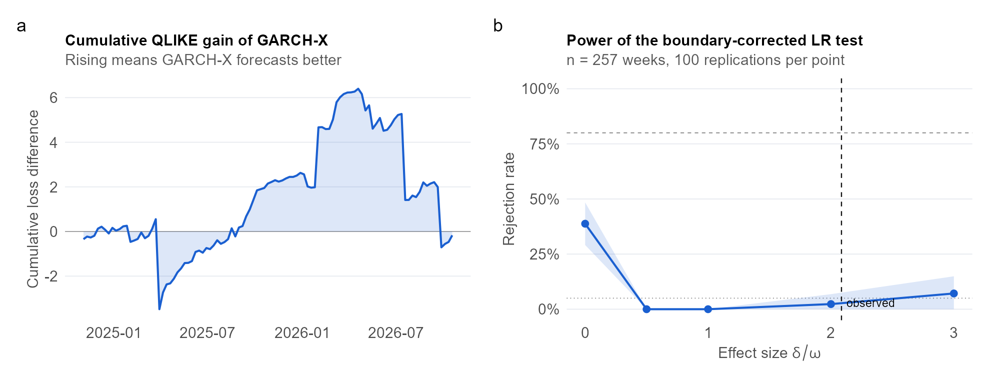

```{r}
#| include: false
# Load the numbers saved by analysis.qmd (shows a dash until that page has been rendered)
res  <- if (file.exists("results/p1_results.rds")) readRDS("results/p1_results.rds") else NULL
val  <- function(k, f = "%.3f") if (is.null(res)) "—" else sprintf(f, res[[k]])   # formatted number
txt  <- function(k) if (is.null(res)) "—" else res[[k]]                          # ready-made text
```

::: {.pf-meta}
| | |
|:--|:--|
| Section and topic | Part 1: Volatility modelling (ARCH and GARCH) |
| Type of project | Exploration and simulation study, with a hand-coded likelihood |
| Data used | Daily USD/ZAR close (Yahoo Finance, `USDZAR=X`) aggregated to weeks, and weekly Google Trends interest for "dollar rand" in South Africa. Period: `r txt("period")` (`r val("n", "%d")` weeks). Both series are public and aggregate, so no personal data and no POPIA consent issue. |
| Methods used | Student-$t$ GARCH(1,1) with a lagged search term in the variance equation (GARCH-X), estimated by constrained quasi-maximum likelihood. GJR-GARCH and EGARCH benchmarks. Boundary-corrected likelihood-ratio test. Out-of-sample QLIKE against realised variance (HAC and block-bootstrap tests). Granger tests with Holm correction. Monte Carlo power study. |
:::

## Question

Does South African search interest in the rand carry information about next-week ZAR/USD volatility beyond what past returns already contain?

## Key findings

```{r}
#| output: asis
# Four headline-number tiles
tile <- function(big, lab) sprintf('<div class="pf-stat"><div class="pf-stat-n">%s</div><div class="pf-stat-l">%s</div></div>', big, lab)
cat('<div class="pf-stats">',
    tile(val("delta"),  "attention coefficient (estimate)"),
    tile(txt("p_c_txt"), "in-sample p-value (boundary-corrected LR)"),
    tile(txt("p_dm_txt"), "out-of-sample p-value (QLIKE, HAC)"),
    tile(txt("mde_txt"), "smallest effect detected with 80% power"),
    '</div>', sep = "\n")
```

- **In sample.** The estimated coefficient is $\hat\delta =$ `r val("delta")` (robust t-ratio from the cross-check fit: `r val("t_rug", "%.2f")`). The boundary-corrected likelihood-ratio test `r txt("v_in")` the null of no attention effect at the 5% level. A sustained move in attention from its minimum to its maximum changes long-run variance by about `r val("share", "%.1f")`%.
- **Out of sample.** Across `r val("n_oos", "%d")` expanding-window forecasts, the mean QLIKE gain of GARCH-X over GARCH is `r val("dq")` (positive favours GARCH-X). The HAC p-value is `r txt("p_dm_txt")` and the block-bootstrap p-value is `r txt("p_boot_txt")`.
- **Direction.** The smallest Holm-adjusted Granger p-value is `r txt("g_fwd_txt")` for search leading volatility and `r txt("g_rev_txt")` for volatility leading search.
- **Power.** The test's empirical size is `r txt("size_txt")`, and it needs an effect of about `r txt("mde_txt")` to reach 80% power. A non-rejection therefore rules out only large effects.

**What this does and does not show.** The results speak to predictive association at weekly frequency. They do not show that searches cause volatility, because attention, trading and news can all move together.

{fig-alt="Two panels: cumulative forecast gain of GARCH-X over GARCH, and the power curve of the likelihood-ratio test."}

## What I would do differently

I would pair daily returns with a MIDAS-style specification instead of aggregating to weeks, and extend the panel to several emerging-market currencies with local search terms to get past the five-year weekly Trends window. I would replace the asymptotic tests with a block bootstrap throughout, and I would fix the search term, lag and loss function in writing before touching the data, which I only partly did here.

## Detailed analysis

[Read the detailed analysis →](analysis.html){.pf-button}

<small>Code and data: [Code & Data appendix](../../appendix/code_and_data.qmd). AI assistance: [AI Use Log](../../appendix/ai_use_log.qmd).</small>