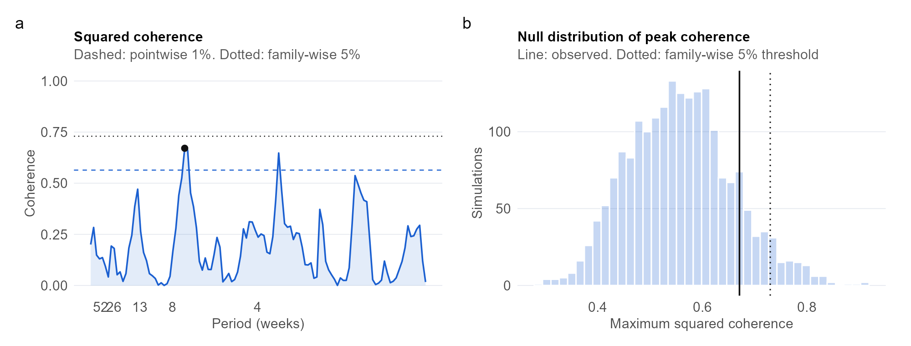

```{r}
#| include: false
# Load the numbers saved by analysis.qmd (shows a dash until that page has been rendered)
res <- if (file.exists("results/p2_results.rds")) readRDS("results/p2_results.rds") else NULL
val <- function(k, f = "%.2f") if (is.null(res)) "—" else sprintf(f, res[[k]])
txt <- function(k) if (is.null(res)) "—" else res[[k]]
```

::: {.pf-meta}
| | |
|:----|:--------------------------------------------|
| Section and topic | Part 1: Spectral analysis and filtering |
| Type of project | Exploration with a simulation check and a hand-coded estimator |
| Data used | Eskom Energy Availability Factor (derived from hourly system data, averaged to weeks) and JSE All Share (last close of each week, Yahoo Finance). Period: `r txt("period")` (`r val("n", "%d")` weekly changes). Both series are public and aggregate, so no personal data and no POPIA consent issue. |
| Methods used | Smoothed cross-spectrum and squared coherence (modified Daniell kernel, hand-coded and validated against `spec.pgram`), phase-implied lead, pointwise F threshold, family-wise threshold from simulated independent series, simulation check of the method, bandwidth, differencing and subsample robustness, linear filtering. |
:::

## Question

At which time scales, if any, do changes in Eskom's grid availability and JSE returns move together, and does either lead?

## Key findings

```{r}
#| output: asis
tile <- function(big, lab) sprintf('<div class="pf-stat"><div class="pf-stat-n">%s</div><div class="pf-stat-l">%s</div></div>', big, lab)
cat('<div class="pf-stats">',
    tile(val("max_coh"), "peak squared coherence"),
    tile(txt("p_fw_txt"), "family-wise p-value of the peak"),
    tile(paste0(val("per_peak", "%.1f"), " wk"), "period of the peak"),
    tile(paste0(val("frac_obs", "%.3f"), " vs ", val("frac_null", "%.3f")), "share above 1% line vs chance"),
    '</div>', sep = "\n")
```

- **Shared time scale.** The family-wise test `r txt("verdict")` the null of no shared frequency at the 5% level. The strongest association has squared coherence `r val("max_coh")` at a period of about `r val("per_peak", "%.1f")` weeks, against a family-wise threshold of `r val("c_fw")`.
- **Breadth.** The share of frequencies above the pointwise 1% line is `r val("frac_obs", "%.3f")`, against `r val("frac_null", "%.3f")` expected by chance under independence.
- **Direction.** `r txt("lead_txt")`
- **Robustness.** `r val("n_rob", "%d")` of `r val("n_alt", "%d")` alternative specifications (bandwidths, detrended EAF, two subsamples) reject at the 5% family-wise level.
- **Method check.** The hand-coded coherence matches `spec.pgram` to within `r val("diff_coh", "%.1e")`, and a simulated 3-week lead is recovered as `r val("lead_est")` weeks.

**What this does and does not show.** Coherence measures linear association by time scale, not causation, and differencing removes the slow movements in which a multi-year recovery would sit. The Eskom data end in September 2023, so the findings cover 2019 to 2023 only.

{fig-alt="Two panels: squared coherence across periods with threshold lines, and the null distribution of peak coherence with the observed value."}

## What I would do differently

I would use a longer window, since about 230 weekly observations resolve cycles slower than a year poorly and the Eskom file stops in September 2023. I would swap the All Share for an index of energy-intensive firms, and use wavelet coherence so the shared time scale can change through time, since load-shedding intensity changed sharply over the sample.

## Detailed analysis

[Read the detailed analysis →](analysis.html){.pf-button}

<small>Code and data: [Code & Data appendix](../../appendix/code_and_data.qmd). AI assistance: [AI Use Log](../../appendix/ai_use_log.qmd).</small>