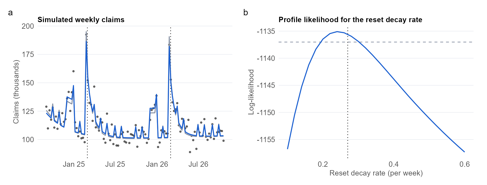

```{r}
#| include: false
# Load the numbers saved by analysis.qmd (shows a dash until that page has been rendered)
res <- if (file.exists("results/p3_results.rds")) readRDS("results/p3_results.rds") else NULL
val <- function(k, f = "%.2f") if (is.null(res)) "—" else sprintf(f, res[[k]])
```

::: {.pf-meta}
| | |
|:----|:--------------------------------------------|
| Section and topic | Part 2: Time series regression models (non-normal response and indicator variables) |
| Type of project | Simulation study with an implementation from first principles, plus a real-data check |
| Data used | **Simulated** weekly withdrawal claims calibrated to published SARS figures (no official weekly series is public), and **real** Google Trends interest in "two pot" in South Africa. Period: `r if (is.null(res)) "—" else res$period` (`r val("n", "%d")` weeks). All inputs are aggregate and public, so no personal data and no POPIA consent issue. |
| Methods used | Negative-binomial regression with an exposure offset, coded as iteratively reweighted least squares with maximum-likelihood dispersion and profiled decay rates, validated against `MASS::glm.nb`; Poisson versus negative-binomial comparison by AIC and dispersion; parameter-recovery and coverage study over 100 simulated series; quasi-Poisson fit to Google Trends. |
:::

## Question

Does the Two-Pot rule (one withdrawal per tax year, resetting on 1 March) leave a measurable signature in weekly claims, and what does a Poisson model get wrong about it?

## Key findings

```{r}
#| output: asis
tile <- function(big, lab) sprintf('<div class="pf-stat"><div class="pf-stat-n">%s</div><div class="pf-stat-l">%s</div></div>', big, lab)
cat('<div class="pf-stats">',
    tile(paste0(val("reset_est", "%.0f"), "% vs ", val("reset_true", "%.0f"), "%"), "reset surge: estimated vs true"),
    tile(paste0(val("theta_hat", "%.0f"), " vs ", val("theta_true", "%.0f")), "dispersion: estimated vs true"),
    tile(paste0(val("cov_nb", "%.2f"), " vs ", val("cov_po", "%.2f")), "interval coverage: negative binomial vs Poisson"),
    tile(paste0(val("tr_reset", "%.0f"), "%"), "reset effect in Google Trends interest"),
    '</div>', sep = "\n")
```

- **Method recovers the truth.** On simulated claims, the estimated reset surge is `r val("reset_est", "%.0f")`% against a true `r val("reset_true", "%.0f")`%, and the launch surge is `r val("launch_est", "%.0f")`% against a true `r val("launch_true", "%.0f")`%.
- **Poisson fails.** Its Pearson dispersion is `r val("phi_pois", "%.0f")` rather than 1, its AIC is `r if (is.null(res)) "—" else format(round(res$d_aic), big.mark = ",")` higher, and its 95% intervals cover the reset effect `r val("cov_po", "%.0f")` of the time in my study against `r val("cov_nb", "%.2f")` for the negative binomial (proportions).
- **Estimator validated.** Coefficients match `MASS::glm.nb` to within `r val("diff_nb", "%.1e")`.
- **Real data.** Google Trends interest shows a reset effect of `r val("tr_reset", "%.0f")`% (95% interval `r val("tr_lo", "%.0f")`% to `r val("tr_hi", "%.0f")`%), with dispersion `r val("tr_phi", "%.1f")`. `r if (is.null(res)) "" else if (res$tr_clear) "The interval excludes zero, so attention rises at the reset." else "The interval includes zero, so attention shows no clear reset effect."`

**What this does and does not show.** The simulation validates the method, not the behavioural story, because the fitted model is the true model. Google Trends measures attention, not claims, so the real-data check is a weak proxy.

{fig-alt="Two panels: simulated weekly claims with fitted and true curves, and the profile likelihood for the reset decay rate."}

## What I would do differently

I would replace the simulation with administrator or FSCA claim data as soon as it exists, since only real counts can test the exhaustion mechanism. I would estimate the decay rates jointly with the other parameters so the standard errors reflect that uncertainty, and add serial correlation through a state-space model, which Project 4 builds.

## Detailed analysis

[Read the detailed analysis →](analysis.html){.pf-button}

<small>Code and data: [Code & Data appendix](../../appendix/code-and-data.qmd). AI assistance: [AI Use Log](../../appendix/ai-use-log.qmd).</small>