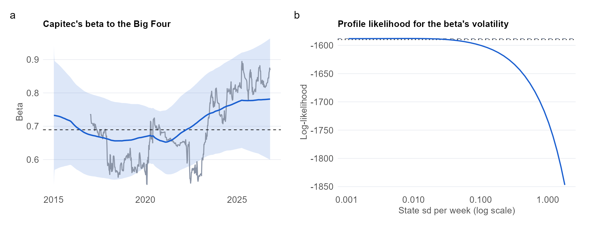

```{r}
#| include: false
# Load the numbers saved by analysis.qmd (shows a dash until that page has been rendered)
res <- if (file.exists("results/p4_results.rds")) readRDS("results/p4_results.rds") else NULL
val <- function(k, f = "%.2f") if (is.null(res)) "—" else sprintf(f, res[[k]])
txt <- function(k) if (is.null(res)) "—" else res[[k]]
```

::: {.pf-meta}
| | |
|:----|:--------------------------------------------|
| Section and topic | Part 2: State-space models and the Kalman filter |
| Type of project | Implementation from first principles, with a model comparison, on real data |
| Data used | Weekly total returns of Capitec (`CPI.JO`), Standard Bank, FirstRand, Absa and Nedbank (equal-weighted composite), and the JSE All Share, from Yahoo Finance. Period: `r txt("period")` (`r val("n", "%d")` weeks). All public aggregate market data, so no personal data and no POPIA consent issue. |
| Methods used | Time-varying regression as a state-space model (random-walk beta, with and without drift); Kalman filter, smoother and likelihood coded by hand and validated against OLS and the `dlm` package; boundary-corrected likelihood-ratio test; profile likelihood; one-step forecast comparison with a Diebold-Mariano test against constant and rolling regressions; robustness to price returns, the market regressor, dropping Absa and sub-samples. |
:::

## Question

Has Capitec's share price become less tied to the Big Four banks over time, as a disruptor story would predict?

## Key findings

```{r}
#| output: asis
tile <- function(big, lab) sprintf('<div class="pf-stat"><div class="pf-stat-n">%s</div><div class="pf-stat-l">%s</div></div>', big, lab)
cat('<div class="pf-stats">',
    tile(paste0(val("b_start"), " to ", val("b_end")), "beta to the Big Four, start to end"),
    tile(val("drift_yr", "%.3f"), "beta drift per year"),
    tile(txt("p_lr"), "p-value that the beta is constant"),
    tile(val("best_ratio", "%.3f"), "best forecast MSE ratio vs OLS"),
    '</div>', sep = "\n")
```

- **Time variation.** The boundary-corrected likelihood-ratio test of a constant beta gives $p$ = `r txt("p_lr")`, and the weekly standard deviation of the beta's change is `r val("sig_eta", "%.4f")`.
- **Drift.** The beta drifts by `r val("drift_yr", "%.3f")` per year (95% interval `r val("d_lo", "%.3f")` to `r val("d_hi", "%.3f")`), from `r val("b_start")` to `r val("b_end")` over the sample. `r if (is.null(res)) "" else if (res$h2) "The interval lies below zero, so the data support a downward drift." else "The interval includes zero, so the data do not establish a drift."`
- **Robustness.** `r val("n_neg", "%d")` of 3 whole-sample alternatives (price returns, the All Share as regressor, the composite without Absa) also show a drift below zero.
- **Forecasting.** The lowest one-step forecast error comes from `r txt("best")`, with an MSE ratio of `r val("best_ratio", "%.3f")` against expanding-window OLS.
- **Estimator check.** The hand-coded filter matches OLS to within `r val("diff_ols", "%.1e")` when the state noise is switched off.

**What this does and does not show.** A falling beta means Capitec has become less tied to the Big Four. It is not proof of disruption, because earnings growth, valuation or ownership changes would produce the same pattern.

{fig-alt="Two panels: the time-varying beta with a band and a rolling estimate, and the profile likelihood for the beta volatility."}

## What I would do differently

I would use a Student-t or GARCH observation error, because the Gaussian errors ignore the volatility clustering I found in Project 1. I would add the market as a second time-varying regressor so the Big Four beta is net of the market, and use market-cap weights in the composite.

## Detailed analysis

[Read the detailed analysis →](analysis.html){.pf-button}

<small>Code and data: [Code & Data appendix](../../appendix/code-and-data.qmd). AI assistance: [AI Use Log](../../appendix/ai-use-log.qmd).</small>